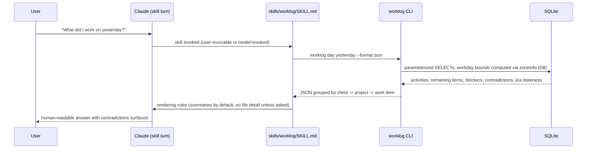
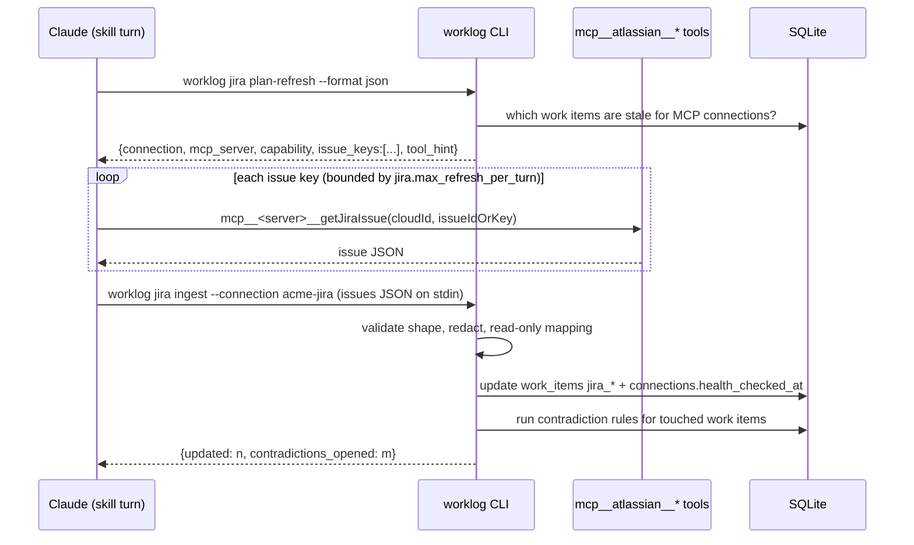

# Work Ledger v1 — Technical Design

**Status:** Implementation-ready
**Spec:** derived from the product specification (this document refines, never weakens, it)
**Scope:** Single-device, single-user, Claude Code only
**Satisfies:** SPEC §23.3 (technical design), §23.4/§23.5 (explicit reliability gaps), §22.12 (ADR — see [`adr/0001-multi-device-sync.md`](adr/0001-multi-device-sync.md))

---

## 1. Design goals restated

Work Ledger is a user-level Claude Code plugin that captures work automatically, stores it durably in one local SQLite database shared across every repository, and answers natural-language questions about it. Two properties dominate every design choice:

1. **Capture must never depend on the model remembering to do anything** (SPEC §16.3). Deterministic hooks own capture; the model only interprets and renders.
2. **Every structured conclusion must be explainable, correctable, and reversible** (SPEC §5.5, §8.1). Raw evidence is append-only; interpretation is a rebuildable projection over it.

Everything else — Jira, summarization, reporting — is allowed to degrade. Capture and auditability are not.

---

## 2. Decisions

These are binding controller rulings for v1. Deviating requires an approved amendment to this document.

| # | Decision | Rationale |
|---|---|---|
| D1 | **Language: Python ≥ 3.10, standard library only at runtime** (`sqlite3`, `json`, `zoneinfo`, `uuid`, `subprocess`, `urllib`, `hashlib`, `argparse`). Package `work_ledger/` under `src/`, entry point `bin/worklog` with shebang `#!/usr/bin/env python3`. No third-party runtime dependency, no build step. | Hooks run on every tool call; a dependency install or a build artifact would make capture fragile and installation heavyweight. |
| D2 | **Configuration is YAML at `~/.claude/work-ledger/config.yaml`.** Use `PyYAML` when importable; otherwise use the vendored `work_ledger/yamlite.py`, a reader/writer for a deliberately small YAML subset (nested maps, lists, scalars of type str/int/bool/null, single/double-quoted strings, `#` comments). **The writer emits only the subset**, so both loaders always agree on any file the plugin itself wrote. | Config must be human-editable YAML (SPEC §12.2/§12.4 examples) without adding a dependency (D1). |
| D3 | **Tests use stdlib `unittest`**, discovered with `python3 -m unittest discover -s tests -v`. | D1. |
| D4 | **Two-layer capture, both deterministic in hooks.** **There are no hook shim scripts** (Ruling 26): `hooks/hooks.json` registers `"${CLAUDE_PLUGIN_ROOT}"/bin/worklog hook <event>` as the command for each event, and `worklog hook` — whose first statement is the `WORK_LEDGER_NESTED` check — reads the hook payload as JSON from stdin, swallows every exception, and always returns 0. **Hook write allowlist (Ruling 8):** hooks may write only through (a) `capture/` — `source_events`, `sessions`, `capture_checkpoints`; (b) `entities` repository upserts — `repositories`, `repository_mappings`; (c) the Stage A projection — `activities`, `activity_evidence`, `remaining_items`, `remaining_item_transitions`, `decisions`, `work_items`, `clients`, `projects`; (d) a bounded REST Jira refresh — `work_items.jira_*`, `connections.health_*`, `contradictions`. Each of (b), (c) and (d) is individually `try/except`-wrapped and time-bounded, so one failing never affects the others or the capture checkpoint; a partial run records `status='partial'` naming the block that failed. Hooks may additionally spawn a detached background job and **never block on Stage B**. They must finish in **< 200 ms typical**, must **never** exit non-zero toward Claude (exit 2 is forbidden — it blocks the user), and must swallow every exception into `~/.claude/work-ledger/logs/hooks.log` plus a `capture_checkpoints` row with `status='failed'`. **Registered events in v1 (Ruling 25, SPEC §23.2):** `SessionStart`, `UserPromptSubmit`, `PostToolUse`, `Stop`, `SubagentStop`, `PreCompact`, `SessionEnd` — and only those; `PostToolUseFailure` and `PostCompact` are unverified and deferred. `PostToolUse`, `UserPromptSubmit` and `SubagentStop` use `"async": true`. `SessionStart`, `Stop` and `PreCompact` may be synchronous but are bounded (`timeout: 10`). `SessionEnd` writes only a marker row (all SessionEnd hooks share a 1.5 s budget). | SPEC §16.3, §19, §23.2. |
| D5 | **Stage A (deterministic) always runs; Stage B (LLM) is best-effort.** Stage A derives client/project from repo path + aliases, ticket keys from `ticket_patterns` matched against branch, commit messages, prompts and tool inputs, commits, files touched, and test commands with pass/fail taken from `Bash` `tool_response`. Stage B is a background job launched by the `Stop` hook: `claude -p --model <configured, default sonnet> --output-format json` with strict JSON-schema output, sentinel env `WORK_LEDGER_NESTED=1` (every hook exits immediately when that variable is set), rate-limited to one run per session per `stage_b.min_interval_minutes`, and auto-disabled when `claude` is not on `PATH`. **If Stage B fails, Stage A results stand with confidence capped at `medium`.** Stage B is re-runnable via `worklog reprocess <session>` and idempotent through source hashes. | SPEC §16.1/§16.2, §19 ("model inference failure: retain raw evidence and create no false structured certainty"). |
| D6 | **Jira has two adapters with different reachability.** `JiraRestAdapter` (urllib, Jira Cloud REST v3, Basic `email:token`, or Bearer PAT for self-managed; **GET only**) is callable from hooks and CLI. `JiraMcpAdapter` is **model-mediated**: setup discovers MCP servers, persists name + capabilities; at query time the skill instructs the model to call `mcp__<server>__*` read tools and pipe the results into `worklog jira ingest --connection <name>` on stdin. There is no way for a hook or script to invoke an MCP tool ad hoc. This is a documented capability gap — see §14.2. | SPEC §11.2/§11.3, §23.4. |
| D7 | **Identifiers: UUIDv7**, generated by a stdlib implementation in `work_ledger/ids.py`. Human display IDs `LOCAL-NNNN` come from a per-device counter table. | SPEC §15 ("preferably UUIDv7"), §10. |
| D8 | **Workdays are computed at query time** from UTC timestamps using `zoneinfo` with `timezone`, `rollover_hour` (default 3) and `nominal_start_hour` (default 8). Never materialized into a stored column. | SPEC §7 ("reporting-day rules are configuration, not permanently materialized truth"). |
| D9 | **Credentials live behind `CredentialStore`.** `KeychainStore` uses macOS `/usr/bin/security`. `EnvRefStore` resolves `env://VAR`. Windows and Linux implementations are stubs that report `unsupported` in v1. References have the form `keychain://work-ledger/<connection-name>`. SQLite and YAML store **only** the reference. | SPEC §12.4, §14.1. |
| D10 | **Secret redaction runs on every excerpt before it is stored, logged, exported, or sent to Stage B.** No exceptions, no opt-out. The named choke points in §12 are a **minimum**, not an exhaustive list: **every sink that persists or emits text redacts** (Ruling 15). | SPEC §14.1. |
| D11 | **The plugin never runs `git commit`, `git push`, or any mutating git command.** Git evidence is read via `subprocess` with argv lists (never `shell=True`) and a 2 s timeout per invocation. | SPEC §2.2. |
| D12 | **Backups use `sqlite3.Connection.backup()`**, never a file copy of an open database. Exports are JSON (complete), Markdown (human), CSV (basic). Import is an idempotent upsert keyed by global `id`. | SPEC §15, §18. |

---

## 3. Component boundaries and module map

Four layers, with a strict dependency direction (each layer may import only from layers above it):

```text
Layer 0  Platform      db/, ids, timeutil, redact, credentials, yamlite, config
Layer 1  Domain        entities, work_items, remaining, decisions, corrections, contradictions
Layer 2  Acquisition   hooks_runtime, transcript, capture/, gitevidence, jira/
Layer 3  Interpretation infer/ (stage_a, stage_b, confidence, dedupe)
Layer 4  Presentation  query/, render, setup, doctor, backup, cli
```

Rules enforced by review (and by `tests/test_layering.py`, Task 38):
- Layer 0 imports nothing from Layers 1–4.
- Nothing outside `db/` opens a SQLite connection.
- Nothing outside `redact.py` decides what a secret looks like.
- Nothing outside `jira/` builds an HTTP request.
- **No SQL string is ever built from user or model text.** All queries are parameterized (SPEC §17).

### 3.1 File map

```text
workledger/
  .claude-plugin/plugin.json          plugin manifest (name: work-ledger)
  .claude-plugin/marketplace.json     local marketplace descriptor for user-level install
  hooks/hooks.json                    hook registrations - the ONLY file under hooks/.
                                      Every command is
                                        "${CLAUDE_PLUGIN_ROOT}"/bin/worklog hook <event>
                                      for the seven verified events (D4, Rulings 25/26):
                                        SessionStart      -> hook session-start
                                        UserPromptSubmit  -> hook user-prompt-submit  (async)
                                        PostToolUse       -> hook post-tool-use       (async)
                                        Stop              -> hook stop
                                        SubagentStop      -> hook subagent-stop       (async)
                                        PreCompact        -> hook pre-compact
                                        SessionEnd        -> hook session-end         (marker only)
                                      There are no hooks/*.py shim scripts.
  skills/worklog/SKILL.md             user-invocable skill; NL -> canonical ops
  bin/worklog                         CLI entry point (python3 shebang)
  src/work_ledger/
    __init__.py        __version__, SCHEMA_VERSION
    cli.py             argparse dispatch for every canonical operation
    paths.py           resolves data dir, db path, log dir, backup dir; honours WORK_LEDGER_HOME
    yamlite.py         minimal YAML subset reader/writer (D2)
    config.py          load/save/defaults/validate config.yaml
    ids.py             uuid7(), new_id(), next_display_id()
    timeutil.py        utc_now_iso(), parse_iso(), workday_of(), workday_bounds(), parse_day_expr()
    textnorm.py        STOPWORDS, STEM_MAP, tokens(), token_set(),
                       normalize_key() / normalize_title() - the SINGLE owner of text
                       normalization, imported by work_items and infer/dedupe (Ruling 23)
    redact.py          redact(text) -> (text, [pattern_names])
    credentials.py     CredentialStore ABC, KeychainStore, EnvRefStore, UnsupportedStore
    db/
      __init__.py
      connection.py    connect(), transaction(), retry-on-busy, WAL/FK/busy_timeout pragmas
      migrations.py    migration runner, advisory lock, checksum verification
      sql/001_core.sql 002_environment.sql 003_capture.sql 004_interpretation.sql
    entities.py        clients, projects, aliases, repositories, repository_mappings
    work_items.py      local + external work items, display IDs, link/merge
    remaining.py       remaining_items + transitions lifecycle
    decisions.py       decisions CRUD
    corrections.py     correction records, apply, undo
    contradictions.py  detection rules, open/resolve lifecycle
    transcript.py      transcript discovery + defensive JSONL parsing
    hooks_runtime.py   `worklog hook <event>` implementation
    capture/
      events.py        append_source_event(), idempotency keys, payload budget
      checkpoints.py   checkpoint(), status recording
      sessions.py      session upsert, lazy finalization, reconcile
    gitevidence.py     bounded git subprocess reads
    infer/
      stage_a.py       deterministic attribution
      stage_b.py       background LLM summarizer + schema validation + idempotent merge
      confidence.py    scoring and policy
      dedupe.py        remaining-item normalization and similarity
      extract.py       deterministic remaining/blocker/decision extraction
    jira/
      adapter.py       JiraAdapter ABC, Capability enum, capability registry
      rest.py          JiraRestAdapter (GET only)
      mcp.py           JiraMcpAdapter (model-mediated) + ingest parser
      factory.py       build_adapter(conn, row) -> JiraAdapter. Owns adapter construction
                       so connections.py never imports jira.rest / jira.mcp (Ruling 13)
      refresh.py       refresh policy, staleness, identity attribution
    connections.py     connection registry, health states, test/repair.
                       Persists rows + capabilities only; imports jira.adapter (a leaf)
                       for the capability vocabulary and nothing else from jira/
    setupwizard.py     resumable, idempotent setup steps
    backup.py          backup/export/import; EXPORT_TABLES (table, pk) and IMPORT_ORDER
    doctor.py          health report
    uninstall.py       inventory() + run(--data / --delete-credentials) with typed
                       confirmation (§15, Ruling 12)
    query/
      daily.py status.py remaining_q.py evidence.py inbox.py stale.py
      render.py        text/markdown rendering shared by all reports
  tests/               stdlib unittest suites, mirrors src layout
  docs/                DESIGN.md, INSTALL.md, adr/, ...
```

### 3.2 On-disk layout (runtime)

```text
~/.claude/work-ledger/
  config.yaml                 non-secret configuration (0600)
  work-ledger.sqlite          the ledger (WAL: -wal, -shm siblings)
  backups/YYYYMMDDTHHMMSSZ-work-ledger.sqlite
  logs/hooks.log              rotating, 5 x 1 MB, redacted
  logs/stage_b.log            rotating, 5 x 1 MB, redacted
  state/setup.json            resumable setup wizard progress
  exports/
```

Directory mode `0700`, file mode `0600`. `doctor` warns (SPEC §15) if the resolved data directory is inside Dropbox, iCloud Drive, Google Drive, OneDrive, or a network mount.

---

## 4. Sequence diagrams

### 4.1 Session start

```mermaid
sequenceDiagram
    participant CC as Claude Code
    participant W as bin/worklog hook session-start
    participant DB as SQLite
    participant J as JiraRestAdapter

    CC->>W: exec "${CLAUDE_PLUGIN_ROOT}"/bin/worklog hook session-start
    Note over CC,W: no shim script - hooks.json invokes bin/worklog directly (D4, Ruling 26)
    CC->>W: stdin {session_id, transcript_path, cwd, reason, permission_mode}
    W->>W: exit 0 immediately if WORK_LEDGER_NESTED=1 (first statement)
    W->>W: read + parse stdin JSON; any failure is logged and returns 0
    W->>DB: apply pending migrations (advisory lock)
    W->>DB: upsert sessions row (session_id, cwd, transcript_path, started_at)
    W->>DB: finalize stale sessions (last_seen_at older than session.idle_finalize_minutes)
    W->>DB: append source_event kind=session_start (idempotency_key=sha256(session_id|session_start|reason))
    opt guarded block (b): repository upsert - own try/except, own time bound
        W->>W: resolve repository from cwd (git rev-parse, 2s timeout)
        W->>DB: upsert repositories + repository_mappings hint
    end
    opt guarded block (d): bounded REST refresh - own try/except, own time bound
        W->>J: GET /rest/api/3/issue/{key} for keys referenced in last N days
        J-->>W: issue fields (or timeout/error)
        W->>DB: update work_items jira_* columns, or mark connection degraded
    end
    W->>DB: capture_checkpoint(status ok|partial|failed, duration_ms)
    W-->>CC: exit 0, no stdout
```

Blocks (b) and (d) are the Ruling 8 allowlist items of the same letters: each is wrapped in its own `try/except` and time bound, so a failing repository resolution or a Jira outage degrades the checkpoint to `partial` without preventing the `session_start` event from being appended.

MCP-backed connections are **not** refreshed here (§14.2 gap G2); they are marked `stale` and refreshed on the first skill turn.

### 4.2 PostToolUse capture

```mermaid
sequenceDiagram
    participant CC as Claude Code
    participant W as bin/worklog hook post-tool-use (async)
    participant R as redact
    participant DB as SQLite

    CC->>W: exec "${CLAUDE_PLUGIN_ROOT}"/bin/worklog hook post-tool-use
    Note over CC,W: no shim script (D4, Ruling 26); WORK_LEDGER_NESTED is checked first
    CC->>W: stdin {session_id, tool_name, tool_input, tool_response, tool_use_id, cwd}
    W->>W: is_interesting(tool_name, tool_input, tool_response)? drop list =
    W->>W: config.get("capture.noise_tools") ONLY (Ruling 24; SPEC 6.2 noise filter)
    alt not interesting
        W->>DB: nothing (or a counter bump in capture_checkpoints)
    else interesting
        W->>W: build compact payload: tool, args of interest, exit code, first/last 400 bytes of output
        W->>R: redact(payload)
        R-->>W: redacted payload + matched pattern names
        W->>W: truncate string leaves to capture.excerpt_max_chars, then cap at payload_max_bytes
        W->>DB: INSERT OR IGNORE source_events (idempotency_key = sha256(session_id|tool_use_id|post_tool_use))
        opt Bash matched git commit/merge/push OR test-runner pattern
            W->>DB: append derived source_event event_type=git_commit_signal / test_run
        end
    end
    W-->>CC: exit 0 (fire and forget)
```

`tool_use_id` makes the idempotency key exact: re-delivery of the same hook payload cannot create a second row (SPEC §20.2). The derived `git_commit_signal` row uses its own idempotency key, `sha256(session_id|git_commit_signal|tool_use_id)`, and `git_commit_signal` is a documented member of the `source_events.event_type` set in §5.3 (Ruling 30(g)).

### 4.3 Stop → checkpoint → Stage A → Stage B

```mermaid
sequenceDiagram
    participant CC as Claude Code
    participant W as worklog hook stop
    participant T as transcript
    participant A as infer.stage_a
    participant G as gitevidence
    participant B as stage-b background job
    participant CL as claude -p
    participant DB as SQLite

    CC->>W: stdin {session_id, transcript_path, last_assistant_message, stop_hook_active}
    W->>W: exit 0 if stop_hook_active or WORK_LEDGER_NESTED=1
    W->>T: reconcile transcript since last watermark (uuid-keyed, defensive parse)
    T-->>W: new records (unknown types ignored)
    W->>DB: append missing source_events (INSERT OR IGNORE)
    W->>G: git log --since session_start --author <identities>, git diff --stat (2s each)
    G-->>W: commits, files touched
    W->>DB: append source_events kind=commit / files_touched
    W->>A: run Stage A over unprocessed events (guarded block (c), own try/except + time bound)
    A->>DB: upsert activities(source='stage_a'), remaining_items, decisions, evidence
    W->>DB: capture_checkpoint(stop, ok|partial)
    W->>B: Popen(detached, start_new_session=True, env WORK_LEDGER_NESTED=1)
    W-->>CC: exit 0 - spawn is the LAST statement; the hook never blocks on B (Ruling 8)
    Note over B,CL: background, outside the user's turn
    B->>DB: rate-limit check (one run per session per min_interval_minutes)
    B->>B: build redacted evidence bundle (<= stage_b.max_bundle_bytes)
    B->>CL: claude -p <prompt> --model sonnet --output-format json
    CL-->>B: JSON result
    B->>B: extract + validate against Stage B schema v1
    alt valid
        B->>DB: merge activities(source='stage_b') by idempotency key = sha256(session|bundle_hash|schema_version)
    else invalid/timeout/claude missing
        B->>DB: capture_checkpoint(stage_b, failed, detail) ; Stage A stands with its
        B->>DB: attribution confidence UNCHANGED; only the narrative is capped (Ruling 6, §6)
    end
```

### 4.4 Skill query — `/worklog today`



The CLI, not the model, does all filtering, grouping and workday math. The model only renders and asks follow-up questions. `--format json` is the contract; `--format text` renders the same data for terminal use.

### 4.5 MCP-mediated Jira refresh



The model is the transport. `worklog jira ingest` treats stdin as **untrusted data**: it validates types, ignores unknown fields, never evaluates anything, and writes only through parameterized statements.

### 4.6 Correction with undo

```mermaid
sequenceDiagram
    participant U as User
    participant M as Claude
    participant C as worklog correct
    participant DB as SQLite

    U->>M: "Move yesterday's activity from AB-326 to AB-76."
    M->>C: worklog correct move-activity --activity <id> --to-ticket AB-76 --reason "..." --format json
    C->>DB: BEGIN
    C->>DB: read current row, snapshot old values
    C->>DB: INSERT corrections(correction_group_id, target_table, target_id, field, old_value_json, new_value_json, operation='move', actor='user')
    C->>DB: UPDATE activities SET work_item_id=?, updated_at=? (soft semantics; source_events untouched)
    C->>DB: optional INSERT aliases (learned rule) with source='correction'
    C->>DB: DELETE FROM summary_cache WHERE scope touched
    C->>DB: COMMIT
    C-->>M: {correction_group_id, changes:[...]} 
    M-->>U: confirmation + "say 'undo that' to revert"
    U->>M: "undo that"
    M->>C: worklog correct undo --group <correction_group_id>
    C->>DB: replay group in reverse, INSERT inverse corrections with undo_of_correction_id
    Note over C,DB: strictly append-only - NO UPDATE of any corrections row (Ruling 7)
    C->>DB: (is-undone is DERIVED: SELECT 1 FROM corrections WHERE undo_of_correction_id = ?)
```

**Corrections are append-only, and undo is a derived property (Ruling 7).** Undo writes one new inverse `corrections` row per original, carrying `undo_of_correction_id`. It never issues `UPDATE corrections …`, and in particular never stamps `undone_at`. "Is this correction undone?" is answered by `corrections.is_undone(conn, correction_id)`, a lookup for a row whose `undo_of_correction_id` matches. The `corrections.undone_at` column remains in migration 004 but is **reserved and never written in v1** — this is what makes the constraint "`corrections` … never updated and never deleted" literally true rather than aspirational.

Immutable `source_events` are never mutated or deleted by a correction (SPEC §15.1). Structured records use soft deletion (`deleted_at`).

---

## 5. Data model

Conventions applied to every table:

- `id TEXT PRIMARY KEY` — UUIDv7 (D7), globally unique, sortable by creation time.
- `origin_device_id TEXT NOT NULL` on every synchronizable record (SPEC §15, ADR-0001).
- `created_at`, `updated_at` — UTC ISO-8601 with `Z` suffix, e.g. `2026-08-30T14:05:09.123Z`.
- `deleted_at TEXT` — soft deletion on structured records only. Append-only tables (`source_events`, `remaining_item_transitions`, `corrections`, `capture_checkpoints`) have no `deleted_at`.
- Event time (`occurred_at`) is always stored separately from ingestion time (`ingested_at`) (SPEC §15.1).
- All uniqueness constraints that must tolerate soft deletion are **partial unique indexes** with `WHERE deleted_at IS NULL`.

### 5.1 Migration 001 — core entities (`db/sql/001_core.sql`)

```sql
CREATE TABLE schema_migrations (
  version     INTEGER PRIMARY KEY,
  name        TEXT NOT NULL,
  checksum    TEXT NOT NULL,
  applied_at  TEXT NOT NULL
);

CREATE TABLE settings (
  key         TEXT PRIMARY KEY,
  value       TEXT NOT NULL,
  updated_at  TEXT NOT NULL
);

CREATE TABLE devices (
  id          TEXT PRIMARY KEY,
  device_key  TEXT NOT NULL UNIQUE,      -- stable per-machine key, generated once
  hostname    TEXT,
  platform    TEXT,
  created_at  TEXT NOT NULL,
  updated_at  TEXT NOT NULL
);

CREATE TABLE display_id_counters (
  scope       TEXT PRIMARY KEY,          -- e.g. 'LOCAL'
  next_value  INTEGER NOT NULL,
  updated_at  TEXT NOT NULL
);

CREATE TABLE clients (
  id               TEXT PRIMARY KEY,
  name             TEXT NOT NULL,
  slug             TEXT NOT NULL,
  notes            TEXT,
  origin_device_id TEXT NOT NULL,
  created_at       TEXT NOT NULL,
  updated_at       TEXT NOT NULL,
  deleted_at       TEXT
);
CREATE UNIQUE INDEX uq_clients_slug ON clients(slug) WHERE deleted_at IS NULL;

CREATE TABLE projects (
  id               TEXT PRIMARY KEY,
  client_id        TEXT NOT NULL REFERENCES clients(id),
  name             TEXT NOT NULL,
  slug             TEXT NOT NULL,
  notes            TEXT,
  origin_device_id TEXT NOT NULL,
  created_at       TEXT NOT NULL,
  updated_at       TEXT NOT NULL,
  deleted_at       TEXT
);
CREATE UNIQUE INDEX uq_projects_client_slug ON projects(client_id, slug) WHERE deleted_at IS NULL;
CREATE INDEX ix_projects_client ON projects(client_id);

CREATE TABLE work_items (
  id                    TEXT PRIMARY KEY,
  kind                  TEXT NOT NULL CHECK (kind IN ('jira','local')),
  client_id             TEXT REFERENCES clients(id),
  project_id            TEXT REFERENCES projects(id),
  connection_id         TEXT,                       -- no SQL-level FK; connection validity is enforced by application code
  external_key          TEXT,                       -- e.g. 'AB-76'
  external_id           TEXT,                       -- Jira numeric/opaque id
  display_id            TEXT,                       -- 'LOCAL-0192' for kind='local'
  title                 TEXT NOT NULL,
  description           TEXT,
  local_state           TEXT NOT NULL DEFAULT 'open'
                        CHECK (local_state IN ('open','in_progress','blocked','waiting','completed','cancelled')),
  jira_status           TEXT,
  jira_status_category  TEXT,                       -- 'new' | 'indeterminate' | 'done'
  jira_resolution       TEXT,
  jira_assignee         TEXT,
  jira_updated_at       TEXT,
  jira_fetched_at       TEXT,
  jira_stale            INTEGER NOT NULL DEFAULT 1,
  merged_into_id        TEXT REFERENCES work_items(id),
  origin_device_id      TEXT NOT NULL,
  created_at            TEXT NOT NULL,
  updated_at            TEXT NOT NULL,
  deleted_at            TEXT
);
-- SPEC 15.1: "Enforce uniqueness for external Jira identity: connection plus issue ID/key."
CREATE UNIQUE INDEX uq_work_items_conn_key ON work_items(connection_id, external_key)
  WHERE deleted_at IS NULL AND connection_id IS NOT NULL AND external_key IS NOT NULL;
CREATE UNIQUE INDEX uq_work_items_conn_extid ON work_items(connection_id, external_id)
  WHERE deleted_at IS NULL AND connection_id IS NOT NULL AND external_id IS NOT NULL;
-- Ruling 18: a free-text ticket key captured by `worklog add` before any connection
-- claims it has connection_id IS NULL, which uq_work_items_conn_key cannot cover.
-- Without this index, repeating "Reviewed AB-76" creates duplicate work_items rows.
CREATE UNIQUE INDEX uq_work_items_orphan_key ON work_items(external_key)
  WHERE connection_id IS NULL AND deleted_at IS NULL;
CREATE UNIQUE INDEX uq_work_items_display ON work_items(display_id)
  WHERE display_id IS NOT NULL;
CREATE INDEX ix_work_items_client_project ON work_items(client_id, project_id);
CREATE INDEX ix_work_items_updated ON work_items(updated_at);

CREATE TABLE work_item_links (
  id               TEXT PRIMARY KEY,
  from_work_item_id TEXT NOT NULL REFERENCES work_items(id),
  to_work_item_id   TEXT NOT NULL REFERENCES work_items(id),
  link_type        TEXT NOT NULL CHECK (link_type IN ('linked_to','merged_into','duplicate_of','supersedes','relates_to')),
  note             TEXT,
  origin_device_id TEXT NOT NULL,
  created_at       TEXT NOT NULL,
  updated_at       TEXT NOT NULL,
  deleted_at       TEXT
);
CREATE UNIQUE INDEX uq_work_item_links ON work_item_links(from_work_item_id, to_work_item_id, link_type)
  WHERE deleted_at IS NULL;

CREATE TABLE aliases (
  id               TEXT PRIMARY KEY,
  alias_kind       TEXT NOT NULL CHECK (alias_kind IN ('client','project','work_item','ticket_prefix','repo_path','git_identity')),
  alias_text       TEXT NOT NULL,           -- stored lowercased/normalized
  target_kind      TEXT NOT NULL CHECK (target_kind IN ('client','project','work_item','connection')),
  target_id        TEXT NOT NULL,
  confidence       TEXT NOT NULL DEFAULT 'high' CHECK (confidence IN ('high','medium','low')),
  source           TEXT NOT NULL CHECK (source IN ('setup','inference','correction','manual')),
  origin_device_id TEXT NOT NULL,
  created_at       TEXT NOT NULL,
  updated_at       TEXT NOT NULL,
  deleted_at       TEXT
);
CREATE UNIQUE INDEX uq_aliases ON aliases(alias_kind, alias_text) WHERE deleted_at IS NULL;
```

### 5.2 Migration 002 — environment and connections (`db/sql/002_environment.sql`)

```sql
CREATE TABLE repositories (
  id               TEXT PRIMARY KEY,
  root_path        TEXT NOT NULL,
  name             TEXT NOT NULL,
  default_branch   TEXT,
  remotes_json     TEXT NOT NULL DEFAULT '[]',
  approved         INTEGER NOT NULL DEFAULT 1,   -- SPEC 12.6: only user-approved locations
  last_seen_at     TEXT,
  origin_device_id TEXT NOT NULL,
  created_at       TEXT NOT NULL,
  updated_at       TEXT NOT NULL,
  deleted_at       TEXT
);
CREATE UNIQUE INDEX uq_repositories_path ON repositories(root_path) WHERE deleted_at IS NULL;

CREATE TABLE repository_mappings (
  id               TEXT PRIMARY KEY,
  repository_id    TEXT NOT NULL REFERENCES repositories(id),
  path_prefix      TEXT NOT NULL DEFAULT '',     -- '' = whole repo; supports monorepo subpaths
  client_id        TEXT REFERENCES clients(id),
  project_id       TEXT REFERENCES projects(id),
  confidence       TEXT NOT NULL CHECK (confidence IN ('high','medium','low')),
  source           TEXT NOT NULL CHECK (source IN ('setup','inference','correction','manual')),
  origin_device_id TEXT NOT NULL,
  created_at       TEXT NOT NULL,
  updated_at       TEXT NOT NULL,
  deleted_at       TEXT
);
CREATE UNIQUE INDEX uq_repo_mappings ON repository_mappings(repository_id, path_prefix) WHERE deleted_at IS NULL;

CREATE TABLE connections (
  id                   TEXT PRIMARY KEY,
  name                 TEXT NOT NULL,
  provider             TEXT NOT NULL DEFAULT 'jira',
  adapter              TEXT NOT NULL CHECK (adapter IN ('mcp','jira-rest')),
  base_url             TEXT,
  cloud_id             TEXT,
  username             TEXT,
  auth_method          TEXT CHECK (auth_method IS NULL OR auth_method IN ('mcp-oauth','cloud-api-token','pat')),
  credential_reference TEXT,                     -- 'keychain://work-ledger/<name>' or 'env://VAR'
  mcp_server_name      TEXT,                     -- e.g. 'atlassian'
  client_hint          TEXT,
  ticket_patterns_json TEXT NOT NULL DEFAULT '[]',
  project_filter_json  TEXT NOT NULL DEFAULT '[]',
  health_state         TEXT NOT NULL DEFAULT 'missing'
                       CHECK (health_state IN ('healthy','degraded','expired','missing','unsupported','disabled')),
  health_detail        TEXT,
  health_checked_at    TEXT,
  enabled              INTEGER NOT NULL DEFAULT 1,
  origin_device_id     TEXT NOT NULL,
  created_at           TEXT NOT NULL,
  updated_at           TEXT NOT NULL,
  deleted_at           TEXT
);
CREATE UNIQUE INDEX uq_connections_name ON connections(name) WHERE deleted_at IS NULL;

CREATE TABLE connection_capabilities (
  id             TEXT PRIMARY KEY,
  connection_id  TEXT NOT NULL REFERENCES connections(id),
  capability     TEXT NOT NULL,   -- identify_current_user|list_sites|list_projects|get_issue|search_issues|get_issue_history|get_user_activity
  supported      INTEGER NOT NULL,
  tool_name      TEXT,            -- for MCP: the concrete mcp__<server>__<tool> that provides it
  detail         TEXT,
  checked_at     TEXT NOT NULL,
  created_at     TEXT NOT NULL,
  updated_at     TEXT NOT NULL
);
CREATE UNIQUE INDEX uq_conn_capability ON connection_capabilities(connection_id, capability);

CREATE TABLE user_identities (
  id               TEXT PRIMARY KEY,
  kind             TEXT NOT NULL CHECK (kind IN ('git','jira')),
  connection_id    TEXT REFERENCES connections(id),
  value            TEXT NOT NULL,     -- git email, or Jira accountId
  display_name     TEXT,
  is_primary       INTEGER NOT NULL DEFAULT 0,
  origin_device_id TEXT NOT NULL,
  created_at       TEXT NOT NULL,
  updated_at       TEXT NOT NULL,
  deleted_at       TEXT
);
CREATE UNIQUE INDEX uq_user_identities ON user_identities(kind, IFNULL(connection_id,''), value)
  WHERE deleted_at IS NULL;
```

### 5.3 Migration 003 — capture (`db/sql/003_capture.sql`)

```sql
CREATE TABLE sessions (
  id               TEXT PRIMARY KEY,
  session_id       TEXT NOT NULL,          -- Claude Code session_id
  transcript_path  TEXT,
  cwd              TEXT,
  git_branch       TEXT,
  repository_id    TEXT REFERENCES repositories(id),
  claude_version   TEXT,
  started_at       TEXT NOT NULL,
  last_seen_at     TEXT NOT NULL,
  ended_at         TEXT,
  end_reason       TEXT,                   -- 'session_end' | 'idle_finalized' | 'clear' | 'unknown'
  transcript_watermark TEXT,               -- last transcript record uuid successfully ingested
  origin_device_id TEXT NOT NULL,
  created_at       TEXT NOT NULL,
  updated_at       TEXT NOT NULL
);
CREATE UNIQUE INDEX uq_sessions_session_id ON sessions(session_id);
CREATE INDEX ix_sessions_last_seen ON sessions(last_seen_at);

CREATE TABLE source_events (               -- APPEND ONLY. Never updated, never deleted.
  id               TEXT PRIMARY KEY,
  session_row_id   TEXT REFERENCES sessions(id),
  session_id       TEXT,
  idempotency_key  TEXT NOT NULL,
  event_type       TEXT NOT NULL,          -- session_start|prompt|tool_use|tool_failure|commit|
                                           -- git_commit_signal|files_touched|test_run|jira_snapshot|
                                           -- manual|compact|subagent_stop|session_end
                                           -- (git_commit_signal added per Ruling 30(g); it is
                                           --  emitted by the PostToolUse hook, see 4.2)
  hook_event       TEXT,
  tool_name        TEXT,
  tool_use_id      TEXT,
  repository_id    TEXT REFERENCES repositories(id),
  git_branch       TEXT,
  cwd              TEXT,
  occurred_at      TEXT NOT NULL,          -- event time
  ingested_at      TEXT NOT NULL,          -- ingestion time (kept separate: SPEC 15.1)
  payload_json     TEXT NOT NULL,          -- redacted, size-capped
  payload_bytes    INTEGER NOT NULL,
  redaction_json   TEXT NOT NULL DEFAULT '[]',
  source_hash      TEXT NOT NULL,
  is_sidechain     INTEGER NOT NULL DEFAULT 0,
  origin_device_id TEXT NOT NULL,
  created_at       TEXT NOT NULL
);
CREATE UNIQUE INDEX uq_source_events_idem ON source_events(idempotency_key);
CREATE INDEX ix_source_events_session_time ON source_events(session_id, occurred_at);
CREATE INDEX ix_source_events_type_time ON source_events(event_type, occurred_at);

CREATE TABLE capture_checkpoints (         -- APPEND ONLY
  id               TEXT PRIMARY KEY,
  session_id       TEXT,
  hook_event       TEXT NOT NULL,
  checkpoint_key   TEXT NOT NULL,
  status           TEXT NOT NULL CHECK (status IN ('ok','partial','failed','skipped')),
  detail           TEXT,
  started_at       TEXT NOT NULL,
  finished_at      TEXT,
  duration_ms      INTEGER,
  origin_device_id TEXT NOT NULL,
  created_at       TEXT NOT NULL
);
CREATE UNIQUE INDEX uq_checkpoint_key ON capture_checkpoints(checkpoint_key);
CREATE INDEX ix_checkpoints_session ON capture_checkpoints(session_id, created_at);
```

### 5.4 Migration 004 — interpretation (`db/sql/004_interpretation.sql`)

```sql
CREATE TABLE activities (
  id                TEXT PRIMARY KEY,
  session_row_id    TEXT REFERENCES sessions(id),
  client_id         TEXT REFERENCES clients(id),
  project_id        TEXT REFERENCES projects(id),
  work_item_id      TEXT REFERENCES work_items(id),
  kind              TEXT NOT NULL CHECK (kind IN ('code','test','investigation','decision','review','manual','other')),
  summary           TEXT NOT NULL,
  outcome           TEXT,
  started_at        TEXT NOT NULL,
  ended_at          TEXT,
  stated_duration_minutes INTEGER,            -- only when the user said it (SPEC 7)
  confidence        TEXT NOT NULL CHECK (confidence IN ('high','medium','low','contradictory')),
  confidence_score  INTEGER NOT NULL DEFAULT 0,
  confidence_reason TEXT,
  source            TEXT NOT NULL CHECK (source IN ('stage_a','stage_b','manual','correction')),
  in_inbox          INTEGER NOT NULL DEFAULT 0,  -- low confidence -> excluded from normal reports
  idempotency_key   TEXT NOT NULL,
  source_hash       TEXT NOT NULL,
  origin_device_id  TEXT NOT NULL,
  created_at        TEXT NOT NULL,
  updated_at        TEXT NOT NULL,
  deleted_at        TEXT
);
CREATE UNIQUE INDEX uq_activities_idem ON activities(idempotency_key);
CREATE INDEX ix_activities_started ON activities(started_at);
CREATE INDEX ix_activities_work_item ON activities(work_item_id, started_at);
CREATE INDEX ix_activities_scope ON activities(client_id, project_id, started_at);
CREATE INDEX ix_activities_inbox ON activities(in_inbox) WHERE in_inbox = 1;

CREATE TABLE activity_evidence (
  id               TEXT PRIMARY KEY,
  activity_id      TEXT NOT NULL REFERENCES activities(id),
  source_event_id  TEXT REFERENCES source_events(id),
  evidence_type    TEXT NOT NULL CHECK (evidence_type IN ('commit','file','tool_call','excerpt','jira','transcript','manual','test')),
  ref              TEXT,                       -- commit sha, file path, issue key, transcript uuid
  excerpt          TEXT,                       -- redacted, <= 512 chars
  occurred_at      TEXT,
  origin_device_id TEXT NOT NULL,
  created_at       TEXT NOT NULL
);
CREATE INDEX ix_activity_evidence_activity ON activity_evidence(activity_id);

CREATE TABLE remaining_items (
  id               TEXT PRIMARY KEY,
  work_item_id     TEXT REFERENCES work_items(id),
  client_id        TEXT REFERENCES clients(id),
  project_id       TEXT REFERENCES projects(id),
  title            TEXT NOT NULL,
  detail           TEXT,
  normalized_key   TEXT NOT NULL,
  state            TEXT NOT NULL CHECK (state IN ('open','in_progress','blocked','waiting','completed','superseded','cancelled','reopened')),
  kind             TEXT NOT NULL DEFAULT 'remaining' CHECK (kind IN ('remaining','blocker','waiting')),
  mention_count    INTEGER NOT NULL DEFAULT 1,
  first_seen_at    TEXT NOT NULL,
  last_seen_at     TEXT NOT NULL,
  resolved_at      TEXT,
  confidence       TEXT NOT NULL CHECK (confidence IN ('high','medium','low','contradictory')),
  source           TEXT NOT NULL CHECK (source IN ('stage_a','stage_b','manual','correction')),
  in_inbox         INTEGER NOT NULL DEFAULT 0,
  origin_device_id TEXT NOT NULL,
  created_at       TEXT NOT NULL,
  updated_at       TEXT NOT NULL,
  deleted_at       TEXT
);
CREATE UNIQUE INDEX uq_remaining_scope_key
  ON remaining_items(IFNULL(work_item_id,''), normalized_key) WHERE deleted_at IS NULL;
CREATE INDEX ix_remaining_state ON remaining_items(state, last_seen_at);

CREATE TABLE remaining_item_transitions (   -- APPEND ONLY
  id                 TEXT PRIMARY KEY,
  remaining_item_id  TEXT NOT NULL REFERENCES remaining_items(id),
  from_state         TEXT,
  to_state           TEXT NOT NULL,
  occurred_at        TEXT NOT NULL,
  source             TEXT NOT NULL CHECK (source IN ('stage_a','stage_b','manual','correction','jira')),
  confidence         TEXT NOT NULL CHECK (confidence IN ('high','medium','low','contradictory')),
  explanation        TEXT,
  source_event_id    TEXT REFERENCES source_events(id),
  activity_id        TEXT REFERENCES activities(id),
  origin_device_id   TEXT NOT NULL,
  created_at         TEXT NOT NULL
);
CREATE INDEX ix_transitions_item ON remaining_item_transitions(remaining_item_id, occurred_at);

CREATE TABLE decisions (
  id               TEXT PRIMARY KEY,
  work_item_id     TEXT REFERENCES work_items(id),
  activity_id      TEXT REFERENCES activities(id),
  client_id        TEXT REFERENCES clients(id),
  project_id       TEXT REFERENCES projects(id),
  statement        TEXT NOT NULL,
  rationale        TEXT,
  decided_at       TEXT NOT NULL,
  confidence       TEXT NOT NULL CHECK (confidence IN ('high','medium','low','contradictory')),
  source           TEXT NOT NULL CHECK (source IN ('stage_a','stage_b','manual','correction')),
  idempotency_key  TEXT NOT NULL,
  origin_device_id TEXT NOT NULL,
  created_at       TEXT NOT NULL,
  updated_at       TEXT NOT NULL,
  deleted_at       TEXT
);
CREATE UNIQUE INDEX uq_decisions_idem ON decisions(idempotency_key);

CREATE TABLE contradictions (
  id               TEXT PRIMARY KEY,
  rule             TEXT NOT NULL,     -- jira_done_open_remaining | jira_open_work_complete |
                                      -- assignee_mismatch | removed_requirement | manual_vs_evidence | possible_duplicate
  work_item_id     TEXT REFERENCES work_items(id),
  subject_table    TEXT,
  subject_id       TEXT,
  ledger_claim     TEXT NOT NULL,
  external_claim   TEXT NOT NULL,
  status           TEXT NOT NULL DEFAULT 'open' CHECK (status IN ('open','acknowledged','resolved','stale')),
  detected_at      TEXT NOT NULL,
  resolved_at      TEXT,
  resolution_note  TEXT,
  origin_device_id TEXT NOT NULL,
  created_at       TEXT NOT NULL,
  updated_at       TEXT NOT NULL,
  deleted_at       TEXT
);
CREATE UNIQUE INDEX uq_contradictions_open
  ON contradictions(rule, IFNULL(work_item_id,''), IFNULL(subject_id,''))
  WHERE status = 'open' AND deleted_at IS NULL;

CREATE TABLE corrections (                  -- APPEND ONLY
  id                   TEXT PRIMARY KEY,
  correction_group_id  TEXT NOT NULL,
  target_table         TEXT NOT NULL,
  target_id            TEXT NOT NULL,
  field                TEXT,
  old_value_json       TEXT,
  new_value_json       TEXT,
  operation            TEXT NOT NULL CHECK (operation IN ('create','update','move','merge','soft_delete','restore','state_change')),
  reason               TEXT,
  actor                TEXT NOT NULL CHECK (actor IN ('user','model')),
  applied_at           TEXT NOT NULL,
  undone_at            TEXT,              -- RESERVED. Never written in v1 (Ruling 7): undo is
                                          -- append-only and "is undone" is derived by looking
                                          -- for a row whose undo_of_correction_id matches.
  undo_of_correction_id TEXT REFERENCES corrections(id),
  origin_device_id     TEXT NOT NULL,
  created_at           TEXT NOT NULL
);
CREATE INDEX ix_corrections_group ON corrections(correction_group_id);
CREATE INDEX ix_corrections_target ON corrections(target_table, target_id);

CREATE TABLE summary_cache (                -- rebuildable cache (SPEC 15.1)
  id           TEXT PRIMARY KEY,
  cache_key    TEXT NOT NULL,
  scope_kind   TEXT NOT NULL CHECK (scope_kind IN ('day','range','client','project','work_item')),
  scope_id     TEXT,
  period_start TEXT,
  period_end   TEXT,
  inputs_hash  TEXT NOT NULL,
  payload_json TEXT NOT NULL,
  built_at     TEXT NOT NULL,
  stale        INTEGER NOT NULL DEFAULT 0
);
CREATE UNIQUE INDEX uq_summary_cache_key ON summary_cache(cache_key);
```

### 5.5 Connection pragmas

Every connection opened by `db/connection.py`:

```sql
PRAGMA journal_mode = WAL;
PRAGMA foreign_keys = ON;
PRAGMA busy_timeout = 5000;
PRAGMA synchronous = NORMAL;
```

Writes are wrapped in `BEGIN IMMEDIATE` and retried up to 5 times with exponential backoff (50/100/200/400/800 ms plus jitter) on `sqlite3.OperationalError` containing `locked` or `busy`. Hook writes use a shorter budget (2 retries) so that a busy database degrades into a recorded `capture_checkpoints` failure rather than a slow hook (SPEC §19).

---

## 6. Confidence policy

Confidence is computed by `infer/confidence.py` as an additive score, then bucketed. It is stored both as the bucket (for queries) and the score + reason (for explanation).

**Signals (points):**

| Signal | Points |
|---|---|
| Explicit manual statement from the user | +100 |
| Ticket key present in the current git branch name and matches a connection's `ticket_patterns` | +35 |
| Ticket key present in a commit message authored by a configured git identity | +30 |
| Ticket key present in the user's prompt text | +20 |
| Ticket key present only in tool input/output (e.g. a file's contents) | +8 |
| Repository resolved through a persisted `repository_mappings` row (`source` in `setup`/`correction`/`manual`) | +40 |
| Repository resolved through a persisted alias | +30 |
| Repository resolved by a fresh name-similarity inference only | +12 |
| Files changed under a path prefix with a persisted mapping | +15 |
| Commit authored by a configured identity | +15 |
| Stage B agreed with the Stage A attribution | +10 |

**Buckets:** `score >= 70` → `high`; `40..69` → `medium`; `< 40` → `low`.

**Overrides (in order):**

1. Two or more ticket keys from different connections with scores within 10 points of each other → `contradictory`. The activity keeps both candidate keys in `confidence_reason`, is attributed to neither, and a `contradictions` row of rule `manual_vs_evidence` is **not** raised (this is an internal ambiguity, surfaced as a conflict warning in reports).
2. A Stage-B-only conclusion with no Stage A anchor is capped at `medium`.
3. **If Stage B did not run or failed, attribution confidence is unchanged; the *narrative* is capped (Ruling 6).** Stage A's deterministic attribution MAY be `high` when it is backed by a **direct signal** — a ticket key in the git branch name (`ticket_in_branch`) or in a commit message (`ticket_in_commit_message`) — regardless of whether Stage B ran. What Stage B's absence caps is the prose, not the attribution: the activity's `summary` stays a Stage A template (§9.1), no `source='stage_b'` row is written, and no Stage-B-derived field (model-authored `summary`/`outcome`, `stage_b_agreed` credit) is set. `confidence.classify` records this by appending `"; Stage B did not run — summary is templated Stage A output"` to `confidence_reason` and changing nothing else; `confidence.narrative_policy(stage_b_ran=False)` returns `{"summary": "templated", "allow_stage_b_fields": False}`. The earlier reading — "every activity from that session is capped at `medium`" — contradicted D5's own premise that deterministic capture is the reliable layer and the best-effort LLM layer is the one that must not overstate.
4. A manual statement always wins over inference for the same field; the inferred value is preserved in `corrections.old_value_json` when a correction supersedes it.

Restated as one rule: **the `medium` ceiling belongs to model-authored conclusions.** Stage B alone never exceeds `medium` (override 2); a Stage-A-only *summary* is templated rather than narrated (override 3); deterministic attribution is scored on its evidence and may reach `high` (§6 signal table).

**Behavior by bucket (SPEC §8.1):**

| Bucket | `in_inbox` | Appears in normal reports | Marked in output |
|---|---|---|---|
| high | 0 | yes | no |
| medium | 0 | yes | yes — "inferred" |
| low | 1 | no | inference inbox only (`worklog inferences`) |
| contradictory | 0 | yes | yes — conflict warning with competing evidence |

Low confidence never blocks capture and never prompts the user. Scores are never inflated to dodge the inbox.

---

## 7. Remaining-item deduplication rules

Implemented in `infer/dedupe.py`. Goal (SPEC §9): repeated mentions reinforce; materially different tasks never silently merge.

**Normalization** — `normalize_key(title) -> str`. **Ruling 23: this pipeline lives in `work_ledger/textnorm.py` (Layer 0) and nowhere else.** `infer/dedupe.py` imports it, and `work_items.normalize_title` **is the same function under a second name** — there is exactly one stopword list and one stemming map in the codebase, and `tests/test_layering.py` fails if a second appears.

1. Lowercase; NFKD-normalize; strip accents.
2. Replace every non-alphanumeric run with a single space.
3. Drop a fixed stopword list (`the a an to of for and or in on is be with that this it we i need needs should must still remaining left todo`).
4. Apply a small stemming map for verb noise (`fixing|fixed|fixes -> fix`, `testing|tested -> test`, **`retesting|retested -> retest`** (Ruling 3), `implementing|implemented -> implement`, `adding|added -> add`, `updating|updated -> update`, `removing|removed -> remove`).
5. Keep the sorted set of remaining tokens; join with `-`; truncate to 120 characters.

**Matching** — candidates are existing non-deleted `remaining_items` scoped to the same `work_item_id` (or, when the item has no work item, the same `project_id`).

| Condition | Action |
|---|---|
| `normalized_key` equal | **Reinforce**: `mention_count += 1`, `last_seen_at = event time`, append an evidence row. No new item, no transition unless state changed. |
| Jaccard token similarity ≥ 0.85 **and** no material-difference signal | Reinforce as above; store the new phrasing in `detail` if it is longer. |
| Similarity 0.60–0.85 | **Create a new item** and open a `contradictions` row with `rule='possible_duplicate'` referencing both ids, for the user to merge or dismiss. Never merge automatically. Worked example (Ruling 4): `"Retest upload recovery on replay hardware"` → `{retest, upload, recovery, replay, hardware}` and `"Retest the upload recovery on replay hardware after reboot"` → `{retest, upload, recovery, replay, hardware, after, reboot}` give 5 ∩ / 7 ∪ = **0.714**, inside the band. |
| Similarity < 0.60 | Create a new item. |

**Material-difference signals** (force a new item regardless of similarity): the two titles reference different ticket keys; different file paths; different environment/host names; or one contains a negation (`not`, `no longer`, `without`) the other lacks.

**State inference on reinforcement:** an existing item transitions only on an explicit signal — a manual statement, a Stage B `state` field with a matching evidence event, or a commit message containing a close marker (`fixes|closes|resolves <key>`). Silence never completes an item.

---

## 8. Contradiction rules

Implemented in `contradictions.py`; evaluated after every Jira refresh, after Stage A/B merges, and before rendering any status report.

| Rule | Condition | Ledger claim / external claim |
|---|---|---|
| `jira_done_open_remaining` | `work_items.jira_status_category='done'` AND ≥1 non-deleted `remaining_items` whose state is in `remaining.OPEN_STATES` = `open`/`in_progress`/`blocked`/`waiting`/**`reopened`** (Ruling 28) | "N remaining items still open" / "Jira status Done (resolution R)" |
| `jira_open_work_complete` | `jira_status_category` in (`new`,`indeterminate`) AND zero remaining items in `remaining.OPEN_STATES` (so a `reopened` item correctly suppresses this rule) AND ≥1 activity in the last 14 days whose `outcome` matches a completion marker | "All known work complete" / "Jira status S" |
| `assignee_mismatch` | `work_items.jira_assignee` is set and is not any `user_identities` value for that connection, AND the ledger has an activity by the user on that item in the last 30 days | "Recent work attributed to you" / "Assigned to X" |
| `removed_requirement` | A remaining item references a Jira issue whose refresh returns 404/`gone`, or a subtask key no longer present in the parent's payload | "Ledger item references R" / "Issue no longer present in Jira" |
| `manual_vs_evidence` | A manual statement marked an item completed, and later evidence (commit/test/tool events) touches the same normalized key | "User said completed at T" / "Evidence of continued work at T2" |
| `possible_duplicate` | §7 similarity band 0.60–0.85 | Both item titles |

**Ruling 28 — `reopened` is an open state everywhere.** SPEC §9 lists eight lifecycle states, of which five mean "still outstanding". `remaining.OPEN_STATES` (Task 14) is the single tuple `("open","in_progress","blocked","waiting","reopened")`, and it is what `remaining.open_items`, `query.scoped.remaining_report`/`blocked_report`, `query.status.status_report`, and the two Jira rules above all use. Excluding `reopened` — as the earlier four-state list did — made a reopened item silently disappear from `remaining`, `blocked` and `status`, and made the Jira-Done contradiction miss precisely the case it exists to catch.

Lifecycle: a rule that no longer holds sets `status='resolved'`, `resolved_at`, and a machine-written `resolution_note`. A contradiction whose Jira side is `stale` (never refreshed, or refresh older than `jira.stale_after_hours`) is reported with an explicit "Jira data is stale as of T" qualifier rather than suppressed. **The plugin never modifies Jira to resolve a contradiction** (SPEC §3.3, §20.24).

---

## 9. Stage A / Stage B contract

### 9.1 Stage A (deterministic, always runs)

`stage_a.run(conn, session_id, *, since_event_id=None) -> StageAResult`

Inputs: unprocessed `source_events` for the session. Outputs (all with evidence rows): candidate ticket keys with per-signal scores, client/project resolution, activities split **one per (client, project, work_item)** tuple (SPEC §4), deterministic remaining/blocker/decision extraction from commit messages and structured tool results, and test results parsed from `Bash` `tool_response` (exit code plus a bounded set of runner-output patterns: `pytest`, `unittest`, `go test`, `npm test`, `gradle test`, `xcodebuild`).

Stage A never invents prose it cannot source: an activity summary from Stage A is templated (e.g. `"Committed 3 changes on feature/x touching 7 files; test suite passed"`).

### 9.2 Stage B (LLM, best-effort, background)

Command: `worklog stage-b --session <session_id> [--force]`.

Guards, in order: `WORK_LEDGER_NESTED` unset → set it for the child; `claude` present on `PATH`; `stage_b.enabled`; rate limit (one run per session per `stage_b.min_interval_minutes`, default 20, enforced through a `capture_checkpoints` row); bundle non-empty.

Bundle: redacted, ordered `source_events` since the Stage B watermark, capped at `stage_b.max_bundle_bytes` (default 60000) by dropping the oldest low-value events first. The bundle carries **no secrets, no full file contents, no full transcript** (SPEC §14.2, §20.12).

Invocation: `claude -p <prompt> --model <stage_b.model> --output-format json`, `cwd` = a fresh temp directory, `env` with `WORK_LEDGER_NESTED=1`, timeout `stage_b.timeout_seconds` (default 120). Isolation flags (`--setting-sources ""`, `--plugin-dir`) are **verified during implementation** (Task 29) and only adopted if they behave as expected on the installed Claude Code version; if they do not, the sentinel env variable alone is the recursion guard.

Output schema (v1, strictly validated; unknown keys ignored, wrong types rejected):

```json
{
  "schema_version": 1,
  "activities": [
    {
      "kind": "code|test|investigation|decision|review|other",
      "summary": "string, <= 400 chars",
      "outcome": "string|null",
      "ticket_hint": "AB-76|null",
      "client_hint": "string|null",
      "project_hint": "string|null",
      "confidence": "high|medium|low",
      "evidence_event_ids": ["source_event id", "..."],
      "remaining": [{"title": "string", "detail": "string|null", "state": "open|blocked|waiting"}],
      "blockers": [{"title": "string", "detail": "string|null"}],
      "decisions": [{"statement": "string", "rationale": "string|null"}]
    }
  ]
}
```

Merge: `idempotency_key = sha256(session_id + "|" + bundle_hash + "|" + schema_version + "|" + index)`. Re-running with the same bundle updates the same rows; a changed bundle creates new ones. Stage B may enrich a Stage A activity's `summary`/`outcome`; it may not change a `high`-confidence Stage A attribution, and it may not raise confidence above `medium` on its own (§6).

Failure: any guard rejection, timeout, non-zero exit, unparseable output, or schema violation writes `capture_checkpoints(hook_event='stage_b', status='failed', detail=<reason>)` and leaves Stage A output in place **with its attribution confidence unchanged** — the templated Stage A summary stands and no Stage-B-derived field is written (§6 override 3, Ruling 6). `worklog reprocess <session> [--stage a|b|both]` re-runs from raw evidence at any time (SPEC §16.2).

---

## 10. Jira design

### 10.1 Adapter interface

```python
class Capability(str, Enum):
    IDENTIFY_CURRENT_USER = "identify_current_user"
    LIST_SITES            = "list_sites"
    LIST_PROJECTS         = "list_projects"
    GET_ISSUE             = "get_issue"
    SEARCH_ISSUES         = "search_issues"
    GET_ISSUE_HISTORY     = "get_issue_history"
    GET_USER_ACTIVITY     = "get_user_activity"

CAPABILITY_VALUES: frozenset[str] = frozenset(c.value for c in Capability)

class JiraAdapter(ABC):
    name: str
    def capabilities(self) -> dict[str, bool]: ...        # keys are Capability.<M>.value
    def identify_current_user(self) -> IdentityResult: ...
    def get_issue(self, key: str) -> IssueResult: ...
    def search_issues(self, jql: str, limit: int = 50) -> list[IssueResult]: ...
    def health(self) -> HealthResult: ...
```

**Ruling 27 — capabilities are plain strings at every boundary.** `Capability(str, Enum)` hashes by member identity, not by its value, so `{Capability.GET_ISSUE: True}["get_issue"]` raises `KeyError`. The enum is the **vocabulary** (`CAPABILITY_VALUES` is the allowed key set); it is never a dict key. `JiraAdapter.capabilities()`, `connections.record_capabilities(caps, tool_names=...)`, `jira.mcp.CAPABILITY_TOOL_HINTS`, `jira.mcp.map_capabilities`, and the `connection_capabilities.capability` column are all keyed by `str`, built with `Capability.<MEMBER>.value`.

**Ruling 13 — adapter construction lives in `jira/factory.py`.** `build_adapter(conn, connection_row) -> JiraAdapter` dispatches on `connection_row["adapter"]`. It is **not** a method of `connections.py`: `connections` is imported by `jira/mcp.py` and `jira/refresh.py`, so a `connections → jira.rest/jira.mcp` import would be a genuine cycle. `connections.py` persists rows and capabilities only and imports, from `jira/`, nothing but the leaf module `jira.adapter` (for `CAPABILITY_VALUES`). `connections.test_connection`/`repair` obtain an adapter through a **function-local** `from .jira.factory import build_adapter`, which keeps the module-scope import graph acyclic; `tests/test_layering.py` (Task 38) enforces this with `ast`.

`IssueResult` is a normalized dict: `{key, id, summary, status, status_category, resolution, assignee_account_id, assignee_display_name, project_key, updated, url}`. Adapters never expose raw provider payloads to the rest of the system.

**No adapter has a write method.** Read-only is enforced structurally (there is no code path that issues POST/PUT/DELETE), not by a runtime flag (SPEC §11.3, §20.24).

### 10.2 `JiraRestAdapter`

`urllib.request` with an explicit `Authorization` header built from the credential resolved through `CredentialStore` at call time (never cached to disk, never placed in argv). Cloud: Basic `base64(email:token)`. Self-managed: `Bearer <PAT>`. Endpoints used: `GET /rest/api/3/myself`, `GET /rest/api/3/issue/{key}?fields=summary,status,resolution,assignee,project,updated`, `GET /rest/api/3/search/jql`, `GET /rest/api/3/project/search`. Timeout 10 s, one retry on 5xx/timeout, no retry on 4xx. HTTP 401/403 → connection `expired`; connection error/timeout → `degraded`; 404 on a known issue → feeds the `removed_requirement` rule.

### 10.3 `JiraMcpAdapter` (model-mediated)

Setup discovers candidate servers from `~/.claude.json` top-level `mcpServers`, from plugin-provided servers, and from `claude mcp list`, then records `mcp_server_name` and per-capability `tool_name` in `connection_capabilities`. At query time the adapter is a **planner + ingester**, not a caller:

- `worklog jira plan-refresh --format json` returns what the model should fetch and with which tool.
- The model calls the `mcp__<server>__*` read tools. **These must appear in the skill's `allowed-tools` by exact name** — `allowed-tools` supports no wildcard over MCP tool names, and the server name is part of the tool name (Ruling 11). `skills/worklog/SKILL.md` lists the six read-only Atlassian tools and no write tool; a user whose server is registered under a name other than `atlassian` must add the equivalent entries, and until they do the loop degrades to "Jira data is stale".
- `worklog jira ingest --connection <name>` reads the tool results from stdin, validates, redacts, and writes.

MCP credentials are never read, copied, or stored (SPEC §12.3.7, §20.14).

### 10.4 Refresh policy

| Trigger | REST connections | MCP connections |
|---|---|---|
| Session start | refreshed by the hook (bounded: `jira.max_refresh_on_start`, default 10 keys) | marked stale; not refreshed (gap G2) |
| Ticket touched during session | refreshed at the `Stop` hook | marked stale |
| Before a status report | refreshed synchronously in the CLI | the skill runs the plan/ingest loop first (§4.5) |
| Jira unreachable | `health_state` set, `jira_stale=1`, reports annotate "Jira data stale as of T" | same |

A Jira failure never fails a hook, never blocks capture, and never removes ledger history (SPEC §19, §20.9, §20.19).

---

## 11. Credentials

```python
class CredentialStore(ABC):
    scheme: str
    def available(self) -> bool: ...
    def get(self, reference: str) -> str | None: ...
    def set(self, reference: str, secret: str) -> None: ...
    def delete(self, reference: str) -> None: ...
```

- `KeychainStore` (`scheme='keychain'`): `/usr/bin/security find-generic-password -a <account> -s <service> -w` to read; `add-generic-password -U -a <account> -s <service> -w` to write. Service = `work-ledger`, account = connection name. **Argv exposure mitigation:** when a TTY is available, `-w` is passed with no value so `security` prompts and the secret never enters `argv`; the argv form is used only in non-interactive setup and is accompanied by a printed warning (SPEC §14.1 "avoid secrets in process arguments where possible").
- `EnvRefStore` (`scheme='env'`): `env://VAR` resolves `os.environ['VAR']`. `set`/`delete` raise `Unsupported`; setup prints the export line for the user to place in their shell profile.
- `WindowsCredentialStore`, `LinuxSecretServiceStore`: present as classes, `available()` returns `False`, every method raises `UnsupportedCredentialStore`; connections on those platforms are marked `unsupported` and fall back to `env://` (D9).

Removing a connection deletes the credential **reference** only; deleting the actual secret requires `worklog connections remove <name> --delete-credential` and an explicit confirmation (SPEC §14.1).

---

## 12. Redaction

`redact(text: str) -> tuple[str, list[str]]` replaces each match with `[REDACTED:<pattern_name>]` and returns the list of pattern names that fired (stored in `source_events.redaction_json` so `doctor` can report redaction activity without storing what was redacted).

Patterns (v1): `Authorization: Bearer <token>`; `Authorization: Basic <b64>`; Atlassian API tokens (`ATATT[A-Za-z0-9_\-=]{20,}`); GitHub tokens (`gh[pousr]_[A-Za-z0-9]{20,}`); Slack tokens (`xox[abpsr]-[A-Za-z0-9-]{10,}`); AWS access key ids (`(A3T[A-Z0-9]|AKIA|ASIA|ABIA|ACCA)[A-Z0-9]{16}`) and `aws_secret_access_key\s*=\s*\S+`; `api[_-]?key\s*[:=]\s*\S+`; `password\s*[:=]\s*\S+`; `Cookie:`/`Set-Cookie:` header values; JWTs (`eyJ[A-Za-z0-9_\-]{10,}\.[A-Za-z0-9_\-]{10,}\.[A-Za-z0-9_\-]{10,}`); PEM blocks (`-----BEGIN [A-Z ]*PRIVATE KEY-----` … `-----END`); private URL credentials (`://user:pass@`); and environment assignments whose **name** matches `(?i).*(TOKEN|SECRET|KEY|PASSWORD|PASSWD|CREDENTIAL).*` (value replaced, name kept).

Redaction is applied at **these three choke points at minimum** — `capture/events.append_source_event`, `stage_b.build_bundle`, and `backup.export_*` — and, as the governing rule, **every sink that persists or emits text redacts** (Ruling 15, D10). The three named above are the ones through which the overwhelming majority of captured text flows; they are a floor, not a closed set. Other sinks that redact, each required by its own task's tests, are `manual.record` (a user statement may quote a token), `gitevidence.remotes` (URL credentials in a remote), `jira.mcp.ingest` (untrusted stdin), and `hooks_runtime.log_exception` (an exception message may embed a secret). Adding a new sink obliges you to redact in it; it does not oblige you to amend this list.

A test (Task 38, `test_seeded_secrets_never_reach_db_logs_exports_or_backups`) seeds every pattern into a fake session driven through the hook runtime, runs Stage A, takes a backup and produces JSON/Markdown/CSV exports, then asserts none of the literals appear anywhere in the database file's raw bytes, the logs, any export, or the backup — and that `source_events.redaction_json` records that the patterns actually fired (SPEC §20.20).

---

## 13. Threat model

**Assets.** (A1) Ledger database — a detailed record of what the user works on for which client. (A2) Credential secrets in the OS keychain. (A3) Credential references and config. (A4) Transcript excerpts and file paths. (A5) The user's Jira accounts (read access). (A6) The user's shell, invoked via `subprocess`.

**Trust boundaries.** (B1) Claude Code process → hook subprocess (stdin JSON is trusted as to structure, untrusted as to content). (B2) Plugin → OS keychain. (B3) Plugin → Jira over TLS. (B4) Plugin → local git repositories (repository content is attacker-controllable in the general case). (B5) Plugin → nested `claude -p` subprocess (its **output is untrusted data**). (B6) Model → CLI, over `worklog jira ingest` stdin and CLI arguments.

| # | Threat | Mitigation |
|---|---|---|
| T1 | A secret in a prompt, tool output, or diff is persisted to SQLite, logs, exports, or backups | §12 redaction at all three choke points; export scrubber; automated leak test (Task 38); SPEC §14.1 |
| T2 | Prompt injection: repository content or Jira text instructs Stage B to exfiltrate or fabricate | Stage B output is schema-validated data only; it cannot name tables, run commands, or set confidence above `medium`; it is written through parameterized statements; the bundle it sees is already redacted |
| T3 | SQL injection through user text, model text, or Jira fields | Every statement is parameterized; no query is built by string concatenation; identifiers are never taken from input (SPEC §17) |
| T4 | Command injection via repository path, branch name, or ticket key in a `git`/`security`/`claude` invocation | argv lists only, never `shell=True`; paths passed after `--`; 2 s timeouts on git, 10 s on keychain, 120 s on Stage B |
| T5 | Hook recursion: Stage B's nested `claude` triggers hooks, which launch Stage B, unbounded | `WORK_LEDGER_NESTED=1` sentinel checked as the first statement of `worklog hook` — the single hook entry point, since there are no shim scripts (D4, Ruling 26); `stop_hook_active` respected; per-session rate limit; a detached job holds a `capture_checkpoints` lock row |
| T6 | Denial of service: a huge transcript or tool output stalls the session | Hooks never read whole files into memory (line-streaming with a byte budget); payloads capped; `PostToolUse` is `async`; every hook is time-bounded and exits 0 |
| T7 | Blocking the user's session with a non-zero exit | Exit 2 is forbidden by D4; every entry point wraps its body in a top-level `try/except BaseException` that logs and returns 0 |
| T8 | Database corruption or lock storms from concurrent sessions | WAL + `busy_timeout` + `BEGIN IMMEDIATE` + bounded retry; hooks use the short retry budget and record a failed checkpoint instead of waiting (SPEC §20.11) |
| T9 | Silent data loss from placing the DB on a synced filesystem | `doctor` detects Dropbox/iCloud/Google Drive/OneDrive/network mounts and reports a hard warning (SPEC §15) |
| T10 | Local exposure of the ledger to other users on the machine | Data directory `0700`, files `0600`; backups inherit the same modes |
| T11 | The plugin mutating Jira or git | No write code path exists (§10.1, D11); enforced by a test that greps the `jira/` package for non-GET verbs and the codebase for mutating git subcommands |
| T12 | A stolen or over-broad Jira token | Setup warns when `myself` + `project/search` show access far beyond configured `ticket_patterns` (SPEC §14.1); tokens are read-only by usage and stored only in the keychain |
| T13 | Undo abuse erasing history | Undo writes inverse `corrections` rows rather than deleting; `source_events` are never touched; every state is reconstructible |

**Explicitly out of scope for v1:** a hostile local user with the user's own credentials; a compromised Claude Code binary; encryption at rest beyond filesystem permissions (documented in RECOVERY.md).

---

## AI-usage score (added post-v1.0)

`work_items.ai_usage_score` (1-5, NULL = no evidence), `ai_usage_confidence`,
and `ai_usage_reason` are maintained by `infer/ai_usage.py` (migration 005):

- **Deterministic baseline** — `recompute_for_work_item` counts, over the
  ticket's contributing sessions: AI edit-tool calls (`Edit`/`Write`/
  `MultiEdit`/`NotebookEdit`), AI-made commits (`git_commit_signal` rows that
  really created a commit), human-only commits (reconciled `commit` rows in
  sessions with zero AI edits), and real user prompts. Fixed thresholds map
  those to 1-5; the reason string carries the counts. Recomputed at the end
  of `stage_a.run` for every touched work item and after
  `corrections.move_activity` for both sides of the move.
- **Stage B refinement** — the model may suggest a per-activity
  `ai_usage_score`; `merge` clamps it to one step from the deterministic
  baseline and stores it at `medium` confidence at most.
- **Corrections own the value** — `ai_usage_score` is in
  `CORRECTABLE_FIELDS`; a live correction pins the score and every recompute
  and refinement skips it.

## Time on ticket (added post-v1.0)

`query/timespent.py` computes session-active minutes at query time -- no
schema, no stored state. Activity `started_at`/`ended_at` bounds become
intervals (floor `time.min_activity_minutes` for point activities), clipped
to the report window, merged per item (`merge_intervals`) and pooled before
merging for client totals so shared stretches never double-count. Surfaced
by `status_report` (work-item scope, over its recent window) and
`_build_report` (per-item and per-client `minutes` for day/range reports).

## Timesheets (added post-v1.0)

`query/timesheet.py` + `worklog timesheet`: rows grouped by (workday,
ticket) for one client over a workday range, minutes via
`query.timespent`'s merged intervals clipped per day. Client-facing by
default -- AI-usage fields require `--internal`. `--round N` rounds each
row up; day and grand totals sum the rounded rows. Pure query/rendering:
no schema, no stored state. Activities without a work item are skipped
(a timesheet row needs a ticket); they still appear in `worklog day`.

## Git-side capture (added post-v1.0)

`githooks.py` + `worklog githooks` + migration 006 (`human_commits`,
schema 6): an opt-in per-repo `post-commit` hook line (marker-tagged,
append-only into existing hooks, removal deletes only our line; installed
repos tracked in `settings` so uninstall is exact). `githooks capture`
reads HEAD through the read-only git allowlist, redacts, and writes one
row with `session_active` = whether a live session covered the repo.
`infer.ai_usage` counts `session_active=0` rows matching the ticket key as
definitive human commits, sha-deduped against reconciled ones;
`session_active=1` rows stay ambiguous (session-granularity rules own
them). The capture CLI path always exits 0: a broken ledger must never
break `git commit`. Wizard step `githooks` is strictly opt-in.

## 14. Requirements that cannot be implemented reliably (SPEC §23.4/§23.5)

Each gap is stated as the spec requirement, the platform limitation, and the chosen degradation. None of these is papered over with prompt instructions.

### G1 — Session-termination capture is not guaranteed
**Spec:** §5.1 "At session termination when supported." **Limitation:** all `SessionEnd` hooks share a single 1.5 s budget and are not guaranteed to run when the process is killed. **Degradation:** `SessionEnd` writes only a marker `source_event` and updates `sessions.ended_at`. Real finalization is **lazy and idempotent**: `SessionStart`, `worklog doctor`, and every report run `sessions.finalize_stale()`, which finalizes any session whose `last_seen_at` is older than `session.idle_finalize_minutes` (default 30) with `end_reason='idle_finalized'` and runs Stage A over anything unprocessed. Nothing is lost if `SessionEnd` never fires; the ledger simply learns about the end later. The spec's word "when supported" is honored literally.

### G2 — Hooks cannot refresh Jira through MCP
**Spec:** §11.1 "Refresh referenced tickets at session start… tickets touched during a session." **Limitation:** there is no mechanism for a script or hook to invoke an MCP tool ad hoc; only a declarative `"type":"mcp_tool"` hook can call an already-connected server, and servers may not be connected at `SessionStart`. **Degradation:** hooks refresh **REST** connections only — that bounded refresh is allowlist item (d) in D4 (Ruling 8), separately guarded so a Jira outage cannot degrade capture. MCP-backed connections are marked `jira_stale=1` and refreshed during the next skill-driven turn via the plan/ingest loop (§4.5), which requires the `mcp__<server>__*` read tools to be listed by exact name in the skill's `allowed-tools` (Ruling 11, §10.3). Reports always state the Jira data's age. Users who need hook-time refresh are told, in INSTALL.md, to configure a REST connection alongside their MCP one.

### G3 — `transcript_path` may lag the in-memory conversation
**Spec:** §16.1 "Claude session and event identifiers… tool calls and results." **Limitation:** the transcript file may not yet contain the most recent turns when a hook runs. **Degradation:** hooks never depend on the transcript for the events they capture — they write `source_events` directly from hook stdin, which is authoritative for `tool_use_id`, `tool_input` and `tool_response`. Transcript parsing is a **reconciliation pass** (at `Stop`, `PreCompact`, and the next `SessionStart`) that fills gaps, keyed by record `uuid` with `INSERT OR IGNORE`, advancing `sessions.transcript_watermark`. Duplicate delivery is impossible; late delivery is normal and harmless.

**Note on `doctor` during a partial install (Ruling 19).** Several `doctor` checks depend on subsystems that may legitimately not exist yet — hooks not installed, no Jira connection configured, `claude` absent from `PATH`, no transcripts written. Each such check reports **`warn`** with the detail `"<check>: not yet configured/installed"`, never `fail`, so a fresh or partial install reads as `degraded` rather than `unhealthy`. `doctor` never fails on an absent optional subsystem.

### G4 — Subagent transcripts are unverified
**Spec:** §16.1 (capture events relevant to work). **Limitation:** whether sidechain (`isSidechain: true`) records for a subagent land in the parent transcript file, and whether `SubagentStop` carries a usable transcript reference, is not documented and was not verified. **Degradation:** `SubagentStop` records a checkpoint plus a marker event. The reconciliation pass scans the parent transcript for `isSidechain: true` records and ingests them with `source_events.is_sidechain=1`. If none are found, subagent work is attributed to the parent session, its activities are capped at `medium` confidence with `confidence_reason` noting "subagent evidence unavailable", and `worklog doctor` reports `subagent_capture: unverified` so the limitation is visible rather than assumed away.

### G5 — There is no git or Jira event hook
**Spec:** §5.1 "After meaningful Git or Jira events when available." **Limitation:** Claude Code has no git/Jira lifecycle events; only tool-call events exist. **Degradation:** git activity is detected two ways — `PostToolUse` on `Bash` whose command matches `git (commit|merge|push|rebase|cherry-pick)` emits a signal event, and the `Stop` hook runs a bounded `git log --since <session start> --author <identity>` reconciliation. Work committed outside Claude Code between sessions is picked up by the next session's reconciliation for the same repository. Commits by unconfigured identities are stored as evidence but never described as the user's work (SPEC §12.5).

### G6 — Active working time cannot be measured
**Spec:** §7 "Do not treat elapsed session time as productive time." (This is a requirement to *not* infer, and is honored.) **Degradation-by-design:** only `stated_duration_minutes` from an explicit user statement is stored; reports show first/last evidence timestamps and never a computed duration.

### G7 — Windows and Linux credential stores
**Spec:** §12.4 "Windows Credential Manager / Linux Secret Service when available." **Limitation:** v1 targets macOS; the other providers are unverified. **Degradation:** the abstraction exists with macOS implemented; Windows/Linux stores report `unsupported`, connections on those platforms are marked `unsupported`, and setup routes them to `env://` references with a printed warning. No secret is ever written to config or SQLite on any platform.

### G8 — Stage B isolation flags are unverified
**Spec:** §16.3 "Avoid recursively launching the same capture hook." **Limitation:** the exact behavior of `--setting-sources ""` / `--plugin-dir` for suppressing plugin hooks in a nested `claude -p` run has not been verified on this version. **Degradation:** the recursion guard that the design *depends* on is the `WORK_LEDGER_NESTED=1` environment sentinel, which is checked as the first statement of `worklog hook` — the one entry point every registered hook command invokes (D4, Ruling 26) — and needs no Claude Code support. Isolation flags are an optimization, adopted in Task 29 only if a verification step shows they behave as expected.

---

## 15. Install, upgrade, and removal

**Install (user scope).** The repository root is both the plugin and a single-plugin local marketplace: it contains `.claude-plugin/plugin.json` and `.claude-plugin/marketplace.json`. Then:

```text
/plugin marketplace add ~/Documents/code/workledger
/plugin install work-ledger@work-ledger
/worklog setup
```

Development install: `claude --plugin-dir ~/Documents/code/workledger`. Task 1 verifies which of the two install paths the installed Claude Code accepts and INSTALL.md documents the verified one first.

**First run.** The `SessionStart` hook — `"${CLAUDE_PLUGIN_ROOT}"/bin/worklog hook session-start`, invoked directly with no shim script (D4, Ruling 26) — or any CLI command creates `~/.claude/work-ledger/`, applies migrations, and registers the device. `/worklog setup` is resumable through `state/setup.json`: each step is idempotent and re-running it never duplicates a connection, identity, or repository (SPEC §20.18).

**Upgrade.** `/plugin update work-ledger`. Migrations are additive and forward-only; the runner takes an advisory lock (`BEGIN IMMEDIATE` on a `settings` row), verifies each applied migration's checksum, and refuses to run against a database whose `schema_migrations` contains a version newer than the code knows (it reports "database written by a newer Work Ledger" and leaves the data untouched). `worklog doctor` reports the schema version and any pending migrations. No pre-upgrade backup is taken automatically; running `worklog backup --label pre-upgrade` yourself before updating the plugin is recommended (INSTALL.md/UPGRADE.md).

**Removal.** `/plugin uninstall work-ledger` removes the code and hooks. Data is deliberately left behind. `worklog uninstall` (built in Task 20, Ruling 12) prints an inventory and deletes nothing. `worklog uninstall --data` deletes `~/.claude/work-ledger/` after printing that inventory and requiring the user to type the confirmation phrase `delete my work ledger` verbatim (`uninstall.CONFIRMATION_PHRASE`); a mismatch deletes nothing. `--delete-credentials` additionally removes the keychain entries named by each connection's `credential_reference`, and is honored **only** together with `--data` and the correct phrase — never implicit (SPEC §14.1).

---

## 16. Testing strategy

| Layer | What | How |
|---|---|---|
| Unit | yamlite round-trip, redaction, workday math, uuid7 monotonicity, dedupe normalization, confidence scoring | `unittest`, no I/O |
| Schema/migration | fresh create, incremental apply, checksum mismatch, newer-version refusal | temp DB per test |
| Capture | hook stdin fixtures piped to `bin/worklog hook <event>` (there is no shim layer — Ruling 26) → expected `source_events`; replay the same fixture twice → one row | fixture JSON in `tests/fixtures/hooks/` |
| Interpretation | Stage A over a canned event stream; Stage B with a **stubbed** `claude` binary on `PATH` returning fixed JSON (never a real model call in tests) | temp dir shim |
| Concurrency | N processes writing `source_events` concurrently; assert no corruption, no unbounded lock, all rows present | `multiprocessing` |
| Security | seeded-secret leak sweep across DB/log/export/backup (fully written out, no vacuous bodies — Ruling 10); adapter write-verb grep; SQL-construction grep with a narrowed regex plus an `ast` proof that each allowlisted module's identifier source is a module-level constant of string literals (Ruling 9) | `tests/test_security.py` |
| Layering | `ast` analysis of module-scope imports: Layer 0 imports nothing upward, only `db/connection.py` opens SQLite, only `redact.py` defines credential patterns, only `jira/` builds HTTP requests, `connections.py` imports no Jira adapter (Ruling 13), `textnorm` is the sole owner of the stopword list (Ruling 23), and the internal import graph is acyclic | `tests/test_layering.py` |
| Upgrade | apply 001 only, insert representative rows, apply 002–004, assert every row survives with the same ids and no NOT NULL/FK violation; `SCHEMA_VERSION == max(discovered)` | `tests/test_migration_upgrade.py` |
| Acceptance | SPEC §20 criteria 1–24, one named test per criterion or a documented manual procedure | `tests/acceptance/` |

Command: `python3 -m unittest discover -s tests -v`. No network access in any test; the Jira adapters are exercised against a local `http.server` fixture.

---

## 17. Traceability

| Spec section | Where satisfied |
|---|---|
| §4 hierarchy, mixed sessions | §5.1 tables, §9.1 one activity per (client, project, work item) |
| §5.5 corrections | §4.6, `corrections` table, Task 15 |
| §7 workday | D8, `timeutil.workday_of` |
| §8.1 confidence | §6 |
| §9 remaining lifecycle | §7, `remaining_items` + `remaining_item_transitions` |
| §10 local work items | `work_items.kind='local'`, `display_id_counters` |
| §11 Jira | §10, D6 |
| §12 setup | §15, Task 36 |
| §13 connection health | `connections.health_state`, Task 35 |
| §14 security/privacy | §11, §12, §13 |
| §15 storage | §5 |
| §16 capture architecture | §4, §9 |
| §17 command surface | `cli.py` (shared flags on each subparser via `parents=[common_parser()]` — Ruling 1), `skills/worklog/SKILL.md` |
| §18 backup/export | D12, Task 19 |
| §19 failure behavior | §13 T7/T8, §10.4, G1–G8 |
| §20 acceptance | §16, Task 39 |
| §21 phases | plan task ordering |
| §22 deliverables | plan Tasks 1–40 |
| §23.3/4/5 | this document, §14 |
| §22.12 ADR | [`adr/0001-multi-device-sync.md`](adr/0001-multi-device-sync.md) |
